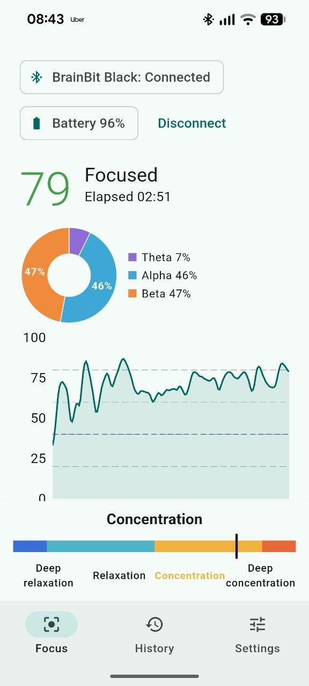
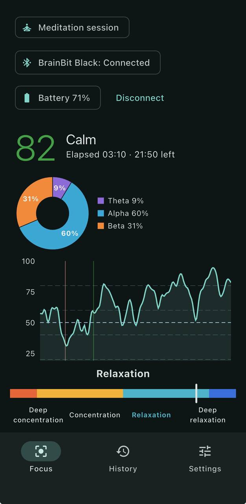

# Focused Mind

A macOS, Android and iPhone app that reads EEG from a BrainBit-family
headband (developed against the **Mindo** band), estimates in real time how
focused or calm you are, and guides you with a soundscape (birds or ocean).

<table align="center">
  <tr>
    <th>Focus session</th>
    <th>Meditation session</th>
  </tr>
  <tr>
    <td></td>
    <td></td>
  </tr>
</table>

## Features

- **Live score** every second: the focus score (or the calm score in a
  meditation session) with its state, elapsed and remaining time, and a
  graph of the whole session.
- **Relaxation–concentration scale**: a gauge with four zones (Deep
  relaxation, Relaxation, Concentration, Deep concentration) centred on your
  own calibrated level, with an adjustable baseline.
- **Brain rhythms**: theta, alpha and beta shares as a pie and as a stacked
  chart over time.
- **Sound feedback** with birds or ocean, a trigger delay, volume and a mute
  button.
- **Sessions** of 25, 50 or 90 minutes or open-ended, with a short signal
  check and calibration first. If the headband drops out briefly, the
  session pauses and resumes.
- **Summary and history**: time per state and per zone, drops or restless
  episodes, the longest focused or calm stretch, and average rhythms.
- **CSV export** of any session, plus an optional recording of the raw EEG.
- **Menu bar indicator** on macOS. On phones, sessions keep running in the
  background.
- **Private**: everything stays on your device.

## Session modes

Choose the mode on the start screen (**Focus | Meditation**). The app
remembers your last choice, and a label at the top of every session screen
shows which one is running.

**Focus session**: rewards concentration. The scale runs from Deep
relaxation on the left to Deep concentration on the right. The sound
follows one of two feedback modes, set in Settings:

- **Alert** (default): quiet while you are focused. The sound fades in when
  your focus drops and fades out when you are back.
- **Continuous**: the sound plays while you are focused, louder the more
  focused you are, and goes quiet when your focus drops.

**Meditation session**: rewards a calm, relaxed state. The score is turned
around: the calm score is 100 − the focus score, and the state is **Calm** or
**Restless**. The scale is mirrored, so the needle moves right as you relax.
The soundscape plays the whole time you are calm, louder the deeper you
relax, and goes silent while you are concentrating (see
[Meditation sessions](#meditation-sessions)).

## In detail

During a session the live view also shows, as in BrainBit's EEGWaves app:

- **Focus scale**, a gauge pinned to the bottom of the window, with four
  zones: Deep relaxation, Relaxation, Concentration and Deep concentration.
  The needle is the focus score. Your calibrated level sits on the
  Relaxation/Concentration boundary (the baseline, 50 by default), and the
  "deep" zones start well away from it (below 12 and above 88 at baseline
  50).
- **Brain rhythms**: a pie of the current theta, alpha and beta shares, and a
  stacked chart of them over the session.

The summary adds time per scale zone, average rhythm shares and the rhythm
chart. Sessions recorded before these existed still open without them.

### Meditation sessions

The start screen has a **Focus | Meditation** selector next to the session
length; it remembers the last type you used. A label at the top of every
session screen (and in History) says which type is running. A meditation
session uses the same headband, calibration, rhythms and history, but its
goal is the calm end of the scale:

- **Calm score**: the big number and the graph show 100 − the focus score,
  so higher is calmer. You are **Calm** in Relaxation or Deep relaxation and
  **Restless** in Concentration or Deep concentration. The boundary is your
  calibrated level (the baseline); the focus threshold isn't used.
- **Mirrored scale**: the gauge runs Deep concentration → Deep relaxation
  from left to right, so the needle moves right as you calm down.
- **Sound**: the soundscape plays the whole time you are calm, louder the
  deeper you relax (full volume in Deep relaxation). After the trigger
  delay in Concentration or above it fades out, and it comes back once you
  are calm again. The Alert/Continuous setting applies only to focus
  sessions.
- **Summary**: time calm, longest calm stretch and restless episodes take
  the place of time focused, longest focus and focus drops.

### Export

In **History**, the share button on a session (or **Export** in its detail
view) asks for a folder (on Android it saves to **Downloads › Focused
Mind** instead) and writes `focused-mind_<date>_<time>.csv`. That
file has one row per second: time, focus score, state, scale zone, theta,
alpha and beta %, gaps, feedback mode, drop/recovery marks and the session
type (`focus` or `meditation`). The focus score is the raw score in both
types; in meditation sessions the state is `calm` or `restless`. Existing
files are never overwritten (`_2`, `_3`, … is appended). On iPhone there is
no folder picker: exports go to **Files › On My iPhone › Focused Mind**.

**Settings › Data › Record raw signal** (off by default) also keeps the full
250 Hz O1/O2/T3/T4 EEG of each new session, about 20 MB per hour. Export
then writes a second file, `…_raw.csv`, in microvolts. Deleting a session
deletes its recording.

> The focus score is an estimate for personal, wellness use only. Focused
> Mind is not a medical device. All data stays on your device.

## Install

Download `FocusedMind-<version>.dmg` from the
[releases](https://github.com/kashubianrodos/focused-mind/releases) and
drag **Focused Mind** into **Applications**.

Release builds are not signed with an Apple Developer ID yet, so macOS
blocks the first launch ("Apple could not verify…"). Right-click › Open no
longer gets past this on macOS 15 and later. To open it:

1. Double-click **Focused Mind**, and click **Done** on the warning.
2. Open **System Settings › Privacy & Security** and scroll down to the
   message that Focused Mind was blocked.
3. Click **Open Anyway** and confirm with your password or Touch ID.

You only need to do this once per downloaded version. On first scan, also
allow Bluetooth access when macOS asks.

Alternatively, clear the download flag in Terminal:
`xattr -dr com.apple.quarantine "/Applications/Focused Mind.app"`.

### Android

Download `FocusedMind-<version>.apk` from the same releases page on the
phone, open it and allow installing from that app when Android asks
(Android 11 or later). Allow **Nearby devices** on first launch. On the
first **Connect**, Android asks to pair with the band: accept it. The
screen stays on while the app is open. A session keeps running when you
switch to other apps, with a "Focus session running" notification (allow
notifications when asked).

Without a release keystore (see [CI and releases](#ci-and-releases)), each
APK is signed with a different key, so uninstall the old version before
installing a new one. Uninstalling deletes the session history; export
sessions first.

### iPhone

The app runs on iPhone (iOS 15 or later; developed for iPhone 15) with the
same features as on the Mac, except the menu bar indicator. Navigation moves
to a bottom bar on a phone, and the session keeps running with the screen
locked: the app declares Bluetooth and audio background modes, and the
feedback sounds play with the silent switch on and mix with your music.

It needs a real iPhone: BrainBit's EmotionalMath framework ships no simulator
slice, and the simulator has no Bluetooth anyway.

There is no App Store or TestFlight build yet. To install it on your own
iPhone with a free Apple ID:

1. In Xcode, **Settings › Accounts**, add your Apple ID.
2. `open ios/Runner.xcworkspace`, select the **Runner** target ›
   **Signing & Capabilities**, tick *Automatically manage signing* and pick
   your *Personal Team*. If the bundle ID is taken, change it to something
   unique (for example `com.<you>.focusedMind`).
3. Connect the iPhone by cable, unlock it and tap **Trust**. On the iPhone,
   turn on **Settings › Privacy & Security › Developer Mode** and restart.
4. Run `flutter run --release -d <your iPhone>` (see `flutter devices`).
5. On the iPhone, allow the developer under **Settings › General › VPN &
   Device Management**, then open Focused Mind and allow Bluetooth.

Apps signed with a free Personal Team expire after 7 days; run step 4 again
to renew. A paid Apple Developer account removes that limit and allows
TestFlight.

To build without signing (for example to re-sign with another tool):
`flutter build ios --release --no-codesign` writes
`build/ios/iphoneos/Runner.app`. CI also publishes an unsigned
`FocusedMind-<version>-unsigned.ipa` (see [CI and releases](#ci-and-releases)):
install it with a tool that re-signs it with your Apple ID, such as
Sideloadly or AltStore.

## Requirements

- macOS 12 or later
- For iPhone builds: the iOS platform in Xcode (**Settings › Components**,
  or `xcodebuild -downloadPlatform iOS`)
- Flutter 3.47+ (Dart 3.13+): `brew install --cask flutter`
- Xcode (full install from the App Store), then
  `sudo xcode-select -s /Applications/Xcode.app/Contents/Developer` and
  `sudo xcodebuild -runFirstLaunch`
- CocoaPods: `brew install cocoapods`

Check with `flutter doctor` (the macOS/Xcode line must be green).

## Run

```sh
flutter pub get
flutter run -d macos
```

Debug builds offer a **Simulated headband** in the scan list, so the whole app
(calibration, focus score, feedback, sessions) works without hardware.

## Tests

```sh
flutter analyze
flutter test                          # unit + widget + host end-to-end tests
flutter test integration_test -d macos  # full simulated sessions in the built app
```

Host tests load BrainBit's prebuilt `libEmStArtifacts.dylib` from the pub
cache, so the focus maths in the tests is the real vendor library.

## CI and releases

`.github/workflows/android.yml` builds `FocusedMind-<version>.apk` on every
push and pull request, and attaches it to the release on `v` tags.
Optional repository secrets sign it with your own key, so new versions
install over old ones:

| Secret | What |
|---|---|
| `ANDROID_KEYSTORE_BASE64` | Release keystore, base64-encoded (`keytool -genkeypair -v -keystore release.jks -keyalg RSA -keysize 2048 -validity 10000 -alias focused-mind`, then `base64 -i release.jks`) |
| `ANDROID_KEYSTORE_PASSWORD`, `ANDROID_KEY_ALIAS`, `ANDROID_KEY_PASSWORD` | Its passwords and alias |

Keep the keystore safe: an app signed with a lost key can't be updated.

`.github/workflows/ios.yml` builds the iPhone app without code signing on
every push and pull request, packages it as
`FocusedMind-<version>-unsigned.ipa` (a run artifact), and attaches it to
the release on `v` tags. It is unsigned because CI has no Apple
certificate; re-sign it with your Apple ID to install it, or build from
source (see [iPhone](#iphone)).

`.github/workflows/macos.yml` runs on GitHub's macOS runners:

- **Every push to `main` and every pull request:** `flutter analyze` and
  `flutter test`, then a release build packaged as a DMG. The DMG is
  attached to the run as an artifact.
- **A tag starting with `v`** (for example `git tag v0.1.0 && git push
  origin v0.1.0`) also publishes a GitHub release with
  `FocusedMind-<version>.dmg`. The version comes from the tag. Tags with a
  `-`, such as `v0.2.0-beta.1`, are marked as pre-releases.

Without signing secrets the app keeps an ad-hoc signature, and users have
to allow the first launch under System Settings › Privacy & Security (see
[Install](#install)). To ship a signed and notarized DMG that opens without
a warning:

1. Join the Apple Developer Program.
2. Create a **Developer ID Application** certificate (Xcode › Settings ›
   Accounts › Manage Certificates), then export it with its private key
   from Keychain Access as a password-protected `.p12`.
3. Create an app-specific password for your Apple ID at appleid.apple.com.
4. Add these repository secrets, for example with
   `gh secret set MACOS_CERTIFICATE_P12 < <(base64 -i cert.p12)`:

| Secret | What |
|---|---|
| `MACOS_CERTIFICATE_P12` | Developer ID Application certificate and key, exported as .p12, base64-encoded (`base64 -i cert.p12 \| pbcopy`) |
| `MACOS_CERTIFICATE_PASSWORD` | Password of that .p12 |
| `MACOS_SIGNING_IDENTITY` | e.g. `Developer ID Application: Your Name (TEAMID)` |
| `APPLE_ID`, `APPLE_TEAM_ID`, `APPLE_APP_SPECIFIC_PASSWORD` | For notarization (`notarytool`); app-specific password from appleid.apple.com |

Then push a new `v` tag. CI signs BrainBit's libraries and the app with the
hardened runtime, notarizes the DMG and staples the ticket.

## Headband

- Switch the band on and keep it close to the Mac, then use **Scan** on the
  Focus page. The last band you connected is offered as one-click connect.
- Before each session the app checks electrode contact (O1/O2 at the back,
  T3/T4 at the temples). Move hair aside under any electrode shown as poor.
- Calibration takes about 10 seconds: sit still with your eyes open. The
  focus score is relative to that calibrated level, which scores the
  **Baseline** (50 by default). If feedback marks you as distracted too
  often, raise the baseline in Settings; lower it for stricter feedback.
- Mindo is reported by the BrainBit SDK as **BrainBit Black** and must be
  paired (bonded) before it connects. Android pairs it on the first
  connect. macOS has no public API for that, so **the Mac app can't
  connect to Mindo yet**. See [docs/hardware.md](docs/hardware.md).

## Project layout

| Path | What |
|---|---|
| `lib/headband/` | Device models, `HeadbandConnection` (timeouts, reconnection), simulator, `NeuroSdkHeadbandSource` and the FFI binding to the neurosdk2 C API |
| `native/`, `hook/build.dart` | C++ shim that copies SDK callback data for Dart, compiled automatically by the build hook |
| `lib/focus/` | `EmotionalMath` estimator, `FocusEngine` (calibration, 1 Hz smoothed score and rhythm shares), baseline-centred `ScoreScale` and scale zones, focus states |
| `lib/feedback/` | Drop/recovery tracking, gain policy for both modes, audio playback |
| `lib/sessions/` | Session lifecycle, recording, local JSON storage, raw EEG recording, CSV export |
| `lib/ui/`, `lib/app/` | Screens, app wiring, menu bar (macOS) |
| `android/` | Android app: Bluetooth permissions, pairing before connect, Downloads folder for export (`MainActivity.kt`) |
| `third_party/neurosdk2/` | Vendored C headers for the FFI binding (`dart run ffigen --config ffigen.yaml`) |
| `assets/sounds/` | Generated soundscapes (`python3 tool/generate_sounds.py`), see `LICENSES.md` |
| `openspec/` | Specs, design and task list for this change |
